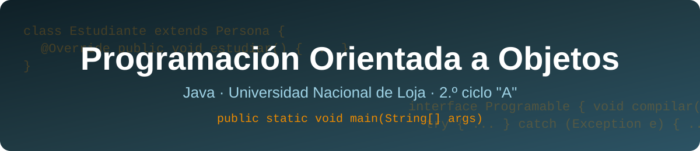

<p align="center"></p>

# ☕ Programación Orientada a Objetos · UNL

<p align="center">


</p>

Repositorio de actividades de aprendizaje de **Programación Orientada a Objetos** con Java.

- 🏛️ **Universidad:** Universidad Nacional de Loja (UNL)
- 👨‍🏫 **Docente:** Ing. Wilman Chamba
- 🎓 **Ciclo:** Segundo ciclo · Paralelo "A"
- 🧑‍💻 **Estudiante:** Erick Emanuel Andrade Montero

## 📚 Actividades

Haz clic en una actividad para abrir su carpeta, con el índice de ejercicios, el código y las evidencias.

| Actividad | Tema | Ejercicios | Estado |
|---|---|:-:|:-:|
| [**U2-AA-3**](U2-AA-3/README.md) | Ejercicios de POO con Java (HackerRank): OOP, Exception Handling y BigNumber | 13 | ✅ |

## ➕ Cómo agregar una nueva actividad

1. Copia la carpeta [`_plantilla-AA`](_plantilla-AA) y renómbrala, por ejemplo `U2-AA-4`.
2. Edita su `README.md` (datos, índice y ejercicios) y guarda el código en subcarpetas numeradas.
3. Agrega una fila a la tabla de **Actividades** de este archivo con el enlace a la nueva carpeta.

## 🗂️ Estructura

```text
POO-UNL/
├── README.md              ← índice general (este archivo)
├── assets/                ← imágenes del repositorio
├── _plantilla-AA/         ← molde para nuevas actividades
└── U2-AA-3/
    ├── README.md          ← índice, explicaciones y declaración de IA
    ├── 01-Java-BigDecimal/
    │   ├── Solution.java
    │   └── evidencias/
    └── ... (13 ejercicios)
```

---

<p align="center">Hecho con ☕ en Loja, Ecuador 🇪🇨</p>
