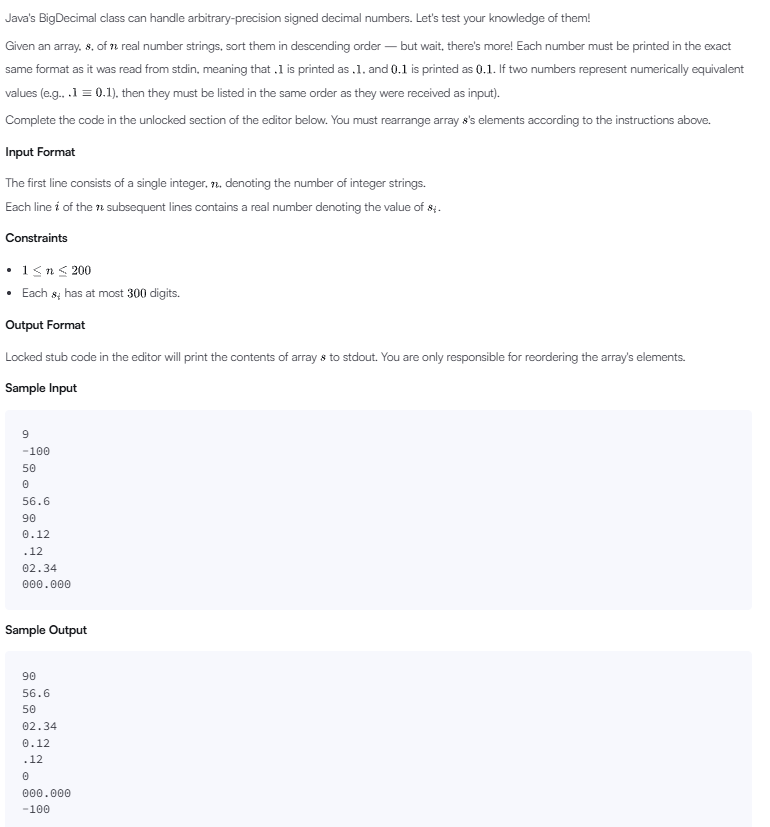
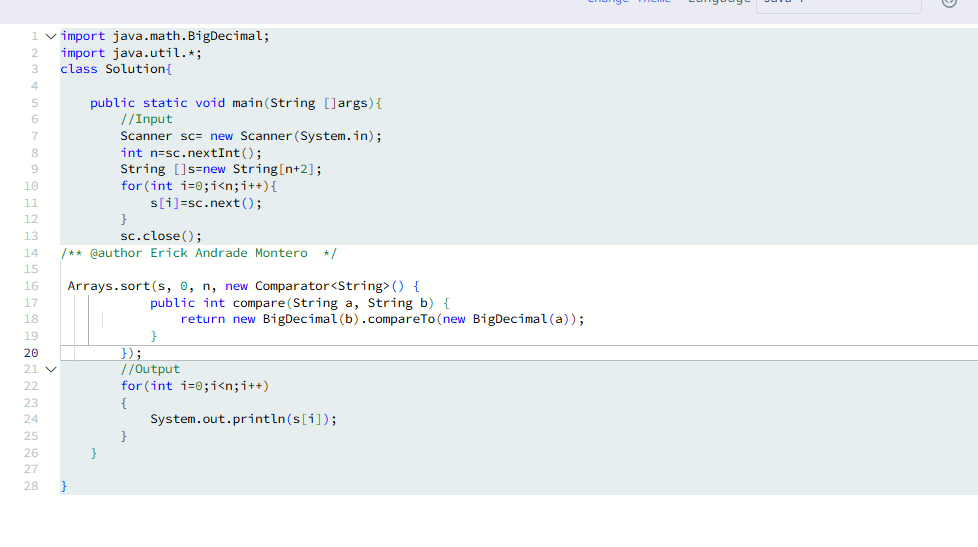
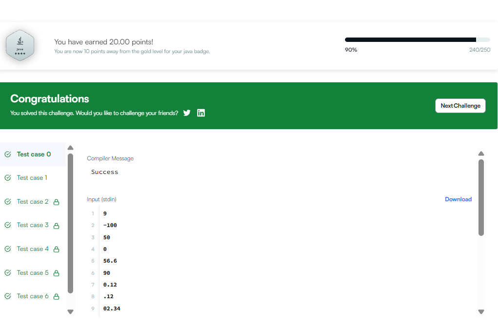

# 1️⃣ Java BigDecimal

`BigNumber` · U2-AA-3 · Ejercicio 1 de 13

⬅️ Anterior · [📑 Índice de la actividad](../README.md#indice) · [Siguiente ➡️](../02-Java-Primality-Test/README.md)

- **Pide:** Ordenar de mayor a menor un arreglo de números reales en texto, sin cambiar su formato; los empates conservan el orden de entrada.
- **Idea:** `Arrays.sort` con un `Comparator` que compara con `BigDecimal` (el sort de objetos es estable).

📄 **Código:** [`Solution.java`](Solution.java)

## 📸 Evidencias

**Enunciado**

**Código**

**Resultado**

⬅️ Anterior · [📑 Índice de la actividad](../README.md#indice) · [Siguiente ➡️](../02-Java-Primality-Test/README.md)

