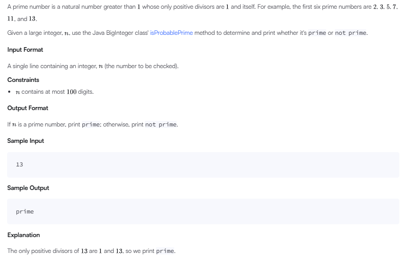
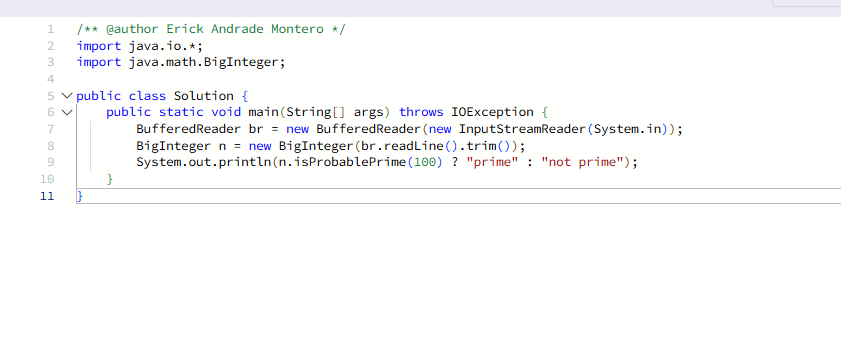
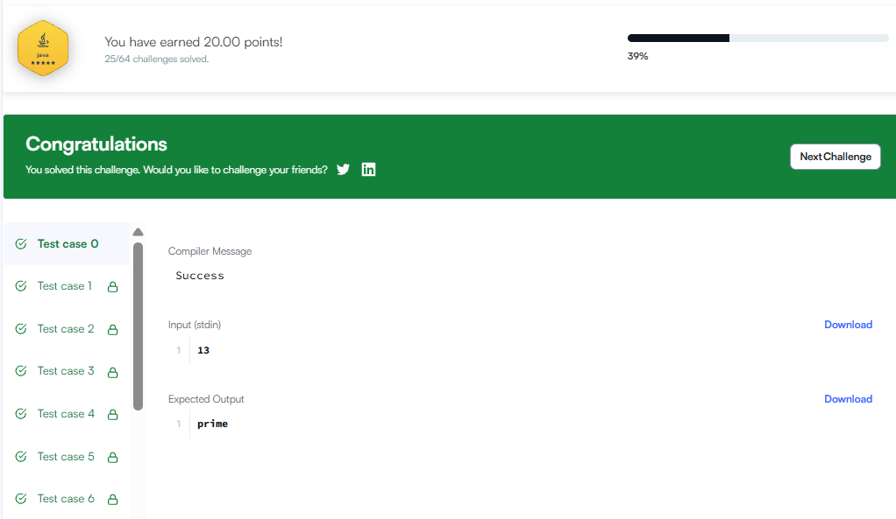

# 2️⃣ Java Primality Test

`BigNumber` · U2-AA-3 · Ejercicio 2 de 13

<a href="../01-Java-BigDecimal/README.md">⬅️ Anterior</a> · <a href="../README.md#indice">📑 Índice de la actividad</a> · <a href="../03-Java-BigInteger/README.md">Siguiente ➡️</a>

- **Pide:** Decir si un número muy grande es primo (`prime`) o no (`not prime`).
- **Idea:** `BigInteger.isProbablePrime(100)` evita recorrer divisores en números enormes.

📄 **Código:** [`Solution.java`](Solution.java)

## 📸 Evidencias

**Enunciado**

**Código**

**Resultado**

<a href="../01-Java-BigDecimal/README.md">⬅️ Anterior</a> · <a href="../README.md#indice">📑 Índice de la actividad</a> · <a href="../03-Java-BigInteger/README.md">Siguiente ➡️</a>

