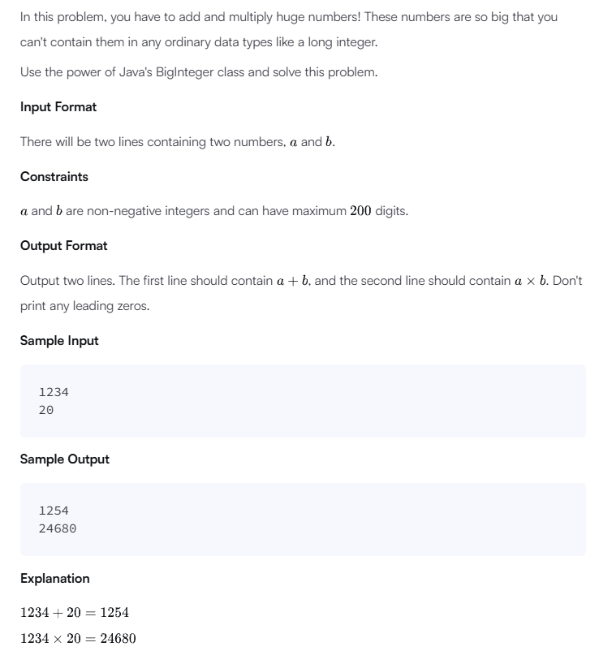
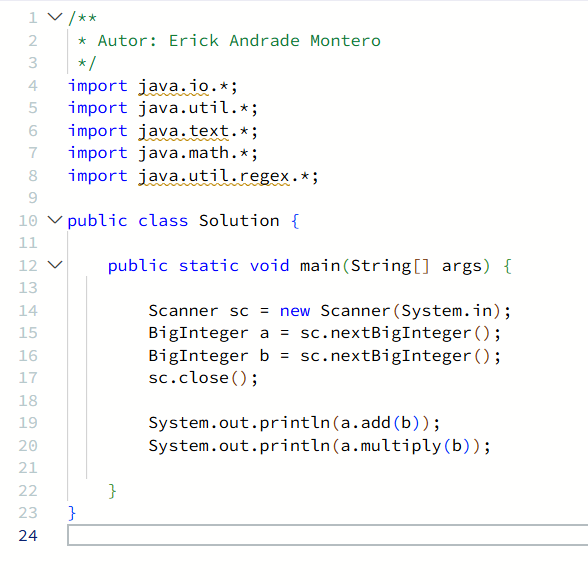

# 3️⃣ Java BigInteger

`BigNumber` · U2-AA-3 · Ejercicio 3 de 13

[⬅️ Anterior](../02-Java-Primality-Test/README.md) · [📑 Índice de la actividad](../README.md#indice) · [Siguiente ➡️](../04-Java-Inheritance-I/README.md)

- **Pide:** Leer dos enteros gigantes e imprimir su suma y su producto.
- **Idea:** `BigInteger` con `add()` y `multiply()`: no hay desbordamiento como con `int` o `long`.

📄 **Código:** [`Solution.java`](Solution.java)

## 📸 Evidencias

**Enunciado**

**Código**

**Resultado**

[⬅️ Anterior](../02-Java-Primality-Test/README.md) · [📑 Índice de la actividad](../README.md#indice) · [Siguiente ➡️](../04-Java-Inheritance-I/README.md)

