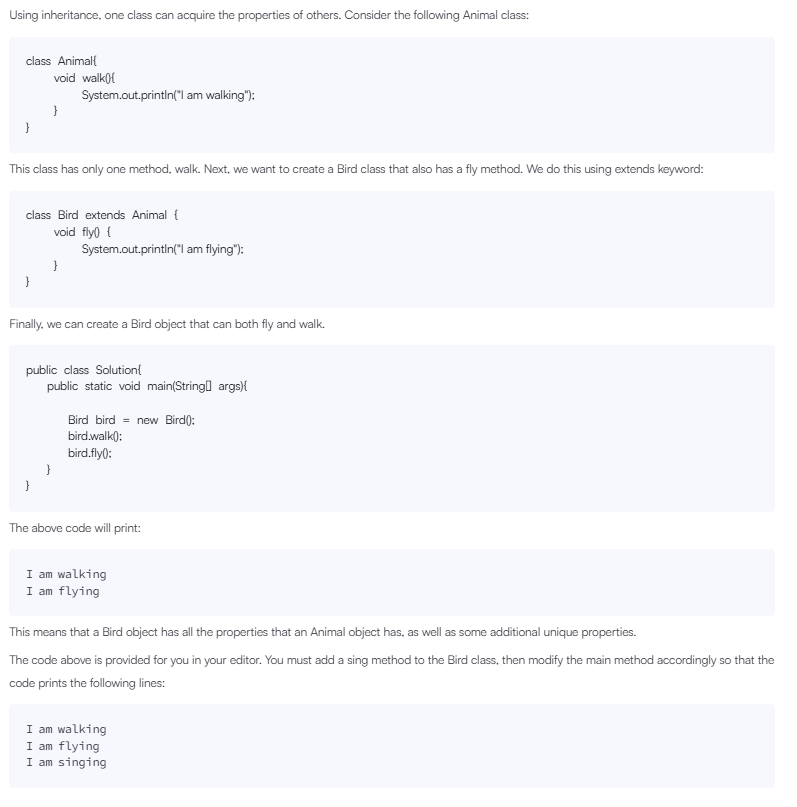
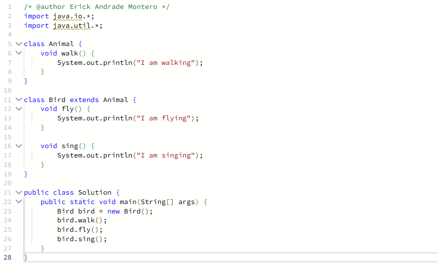
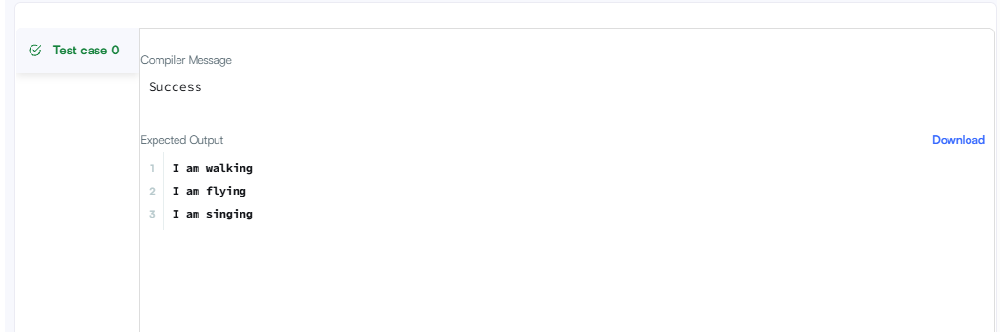

# 4️⃣ Java Inheritance I

`POO · Herencia` · U2-AA-3 · Ejercicio 4 de 13

[⬅️ Anterior](../03-Java-BigInteger/README.md) · [📑 Índice de la actividad](../README.md#indice) · [Siguiente ➡️](../05-Java-Inheritance-II/README.md)

- **Pide:** Hacer que `Bird` herede de `Animal` y tenga además `fly()` y `sing()`.
- **Idea:** Con `extends`, `Bird` reutiliza `walk()` del padre y agrega sus propios métodos.

📄 **Código:** [`Solution.java`](Solution.java)

## 📸 Evidencias

**Enunciado**

**Código**

**Resultado**

[⬅️ Anterior](../03-Java-BigInteger/README.md) · [📑 Índice de la actividad](../README.md#indice) · [Siguiente ➡️](../05-Java-Inheritance-II/README.md)

