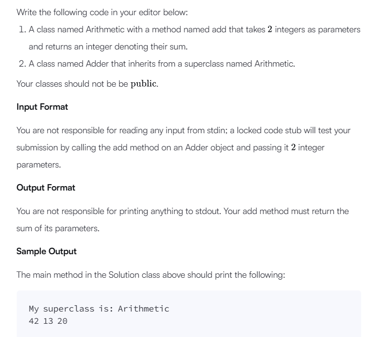
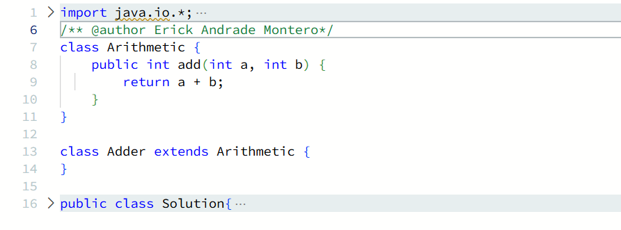
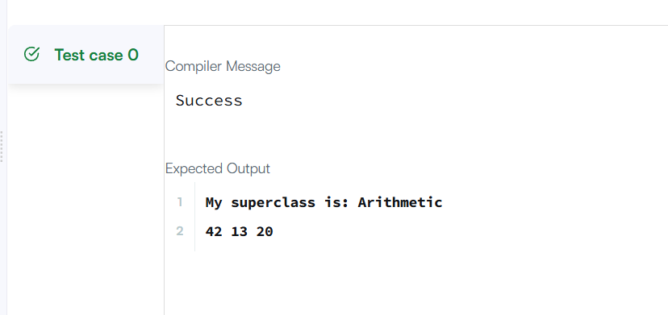

# 5️⃣ Java Inheritance II

`POO · Herencia` · U2-AA-3 · Ejercicio 5 de 13

[⬅️ Anterior](../04-Java-Inheritance-I/README.md) · [📑 Índice de la actividad](../README.md#indice) · [Siguiente ➡️](../06-Java-Abstract-Class/README.md)

- **Pide:** Crear `Adder` que herede de `Arithmetic` y usar su método `add` sin reescribirlo.
- **Idea:** `class Adder extends Arithmetic` y `getClass().getSuperclass().getName()` para mostrar el padre.

📄 **Código:** [`Solution.java`](Solution.java)

## 📸 Evidencias

**Enunciado**

**Código**

**Resultado**

[⬅️ Anterior](../04-Java-Inheritance-I/README.md) · [📑 Índice de la actividad](../README.md#indice) · [Siguiente ➡️](../06-Java-Abstract-Class/README.md)

