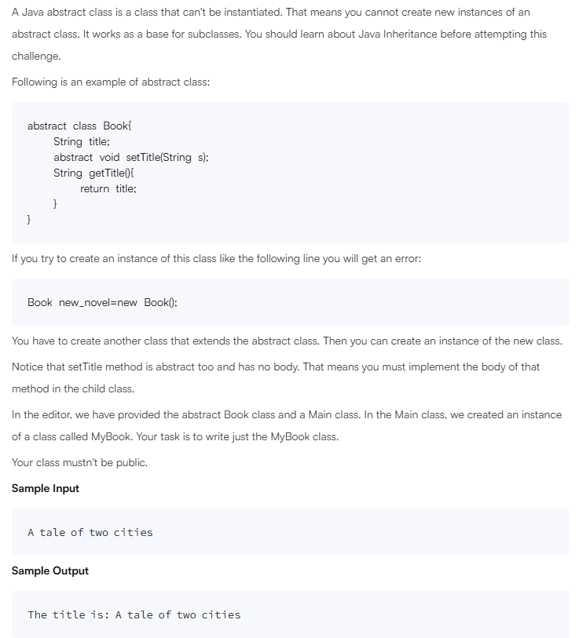
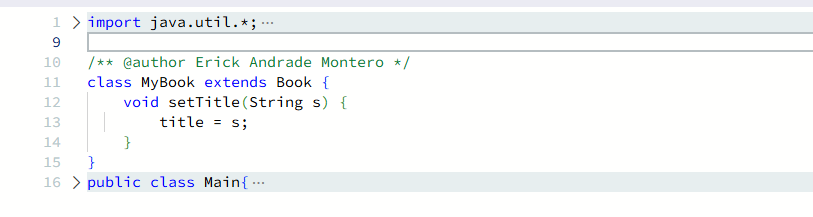
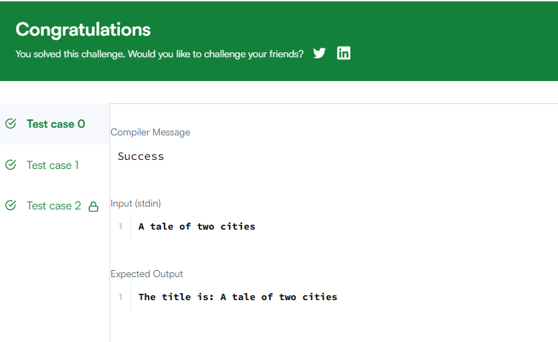

# 6️⃣ Java Abstract Class

`POO · Clases abstractas` · U2-AA-3 · Ejercicio 6 de 13

[⬅️ Anterior](../05-Java-Inheritance-II/README.md) · [📑 Índice de la actividad](../README.md#indice) · [Siguiente ➡️](../07-Java-Interface/README.md)

- **Pide:** Implementar `MyBook` a partir de la clase abstracta `Book` para guardar y mostrar un título.
- **Idea:** Una clase abstracta no se instancia: la hija debe implementar `setTitle`.

📄 **Código:** [`Main.java`](Main.java)

## 📸 Evidencias

**Enunciado**

**Código**

**Resultado**

[⬅️ Anterior](../05-Java-Inheritance-II/README.md) · [📑 Índice de la actividad](../README.md#indice) · [Siguiente ➡️](../07-Java-Interface/README.md)

