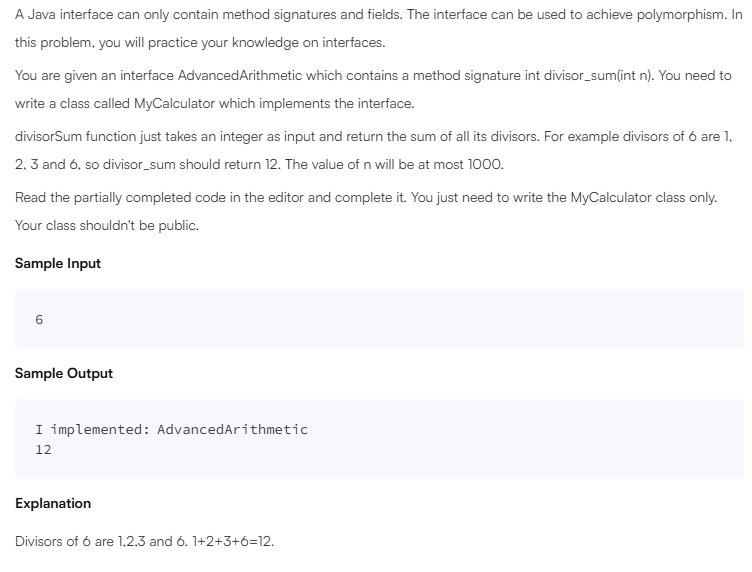
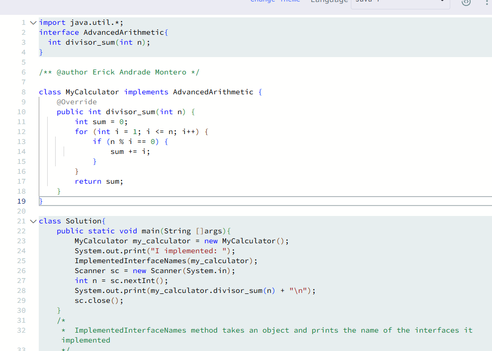
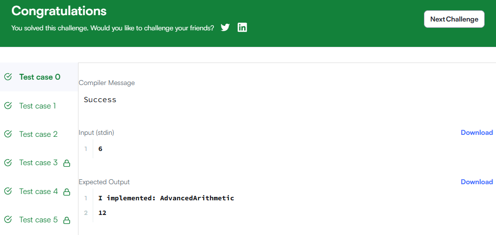

# 7️⃣ Java Interface

`POO · Interfaces` · U2-AA-3 · Ejercicio 7 de 13

[⬅️ Anterior](../06-Java-Abstract-Class/README.md) · [📑 Índice de la actividad](../README.md#indice) · [Siguiente ➡️](../08-Java-Method-Overriding/README.md)

- **Pide:** Implementar `divisor_sum(n)` (suma de los divisores de n) en `MyCalculator`, que implementa `AdvancedArithmetic`.
- **Idea:** Se recorre hasta √n sumando `i` y `n/i`; la interfaz obliga a definir el método.

📄 **Código:** [`Solution.java`](Solution.java)

## 📸 Evidencias

**Enunciado**

**Código**

**Resultado**

[⬅️ Anterior](../06-Java-Abstract-Class/README.md) · [📑 Índice de la actividad](../README.md#indice) · [Siguiente ➡️](../08-Java-Method-Overriding/README.md)

