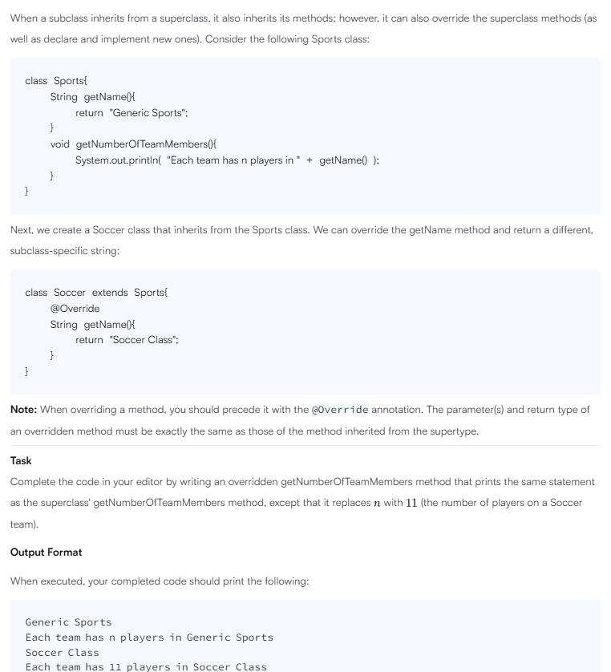
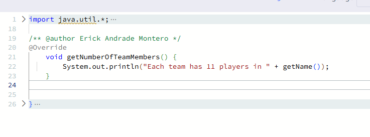
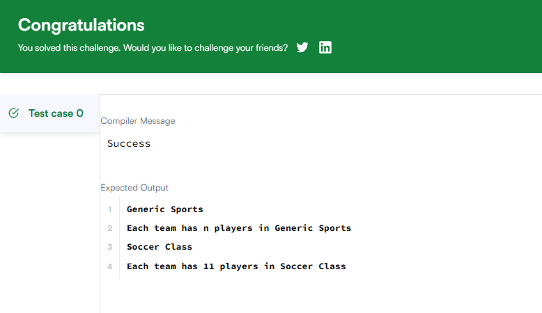

# 8️⃣ Java Method Overriding

`POO · Polimorfismo` · U2-AA-3 · Ejercicio 8 de 13

[⬅️ Anterior](../07-Java-Interface/README.md) · [📑 Índice de la actividad](../README.md#indice) · [Siguiente ➡️](../09-Java-Method-Overriding-2-Super/README.md)

- **Pide:** Sobrescribir en `Soccer` el método `getNumberOfTeamMembers` para que diga que hay 11 jugadores.
- **Idea:** `@Override` cambia el comportamiento heredado; Java elige la versión según el objeto real.

📄 **Código:** [`Solution.java`](Solution.java)

## 📸 Evidencias

**Enunciado**

**Código**

**Resultado**

[⬅️ Anterior](../07-Java-Interface/README.md) · [📑 Índice de la actividad](../README.md#indice) · [Siguiente ➡️](../09-Java-Method-Overriding-2-Super/README.md)

