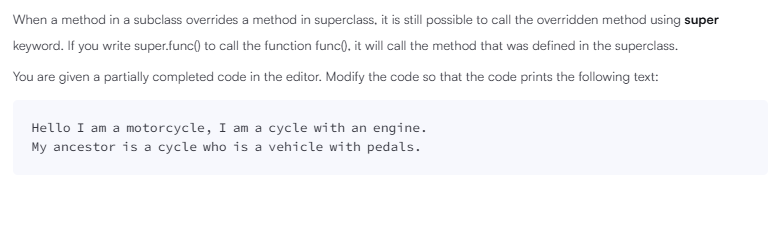
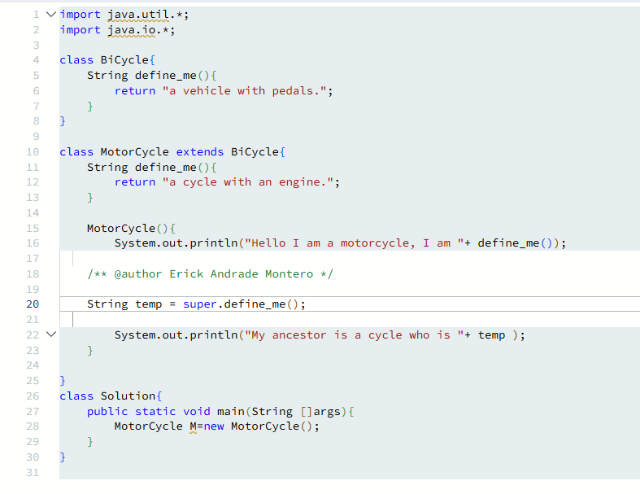
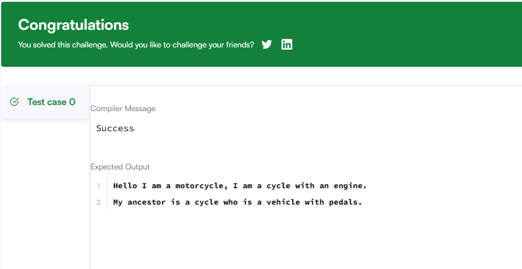

# 9️⃣ Java Method Overriding 2 (Super Keyword)

`POO · Polimorfismo / super` · U2-AA-3 · Ejercicio 9 de 13

<a href="../08-Java-Method-Overriding/README.md">⬅️ Anterior</a> · <a href="../README.md#indice">📑 Índice de la actividad</a> · <a href="../10-Java-Instanceof-Keyword/README.md">Siguiente ➡️</a>

- **Pide:** Hacer que `MotorCycle` llame al `define_me()` de su clase padre `BiCycle`, no al suyo.
- **Idea:** `super.define_me()` accede a la versión del padre aunque el método esté sobrescrito.

📄 **Código:** [`Solution.java`](Solution.java)

## 📸 Evidencias

**Enunciado**

**Código**

**Resultado**

<a href="../08-Java-Method-Overriding/README.md">⬅️ Anterior</a> · <a href="../README.md#indice">📑 Índice de la actividad</a> · <a href="../10-Java-Instanceof-Keyword/README.md">Siguiente ➡️</a>

