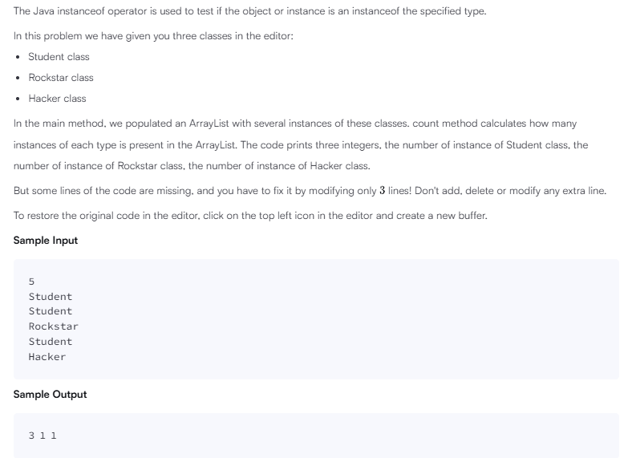
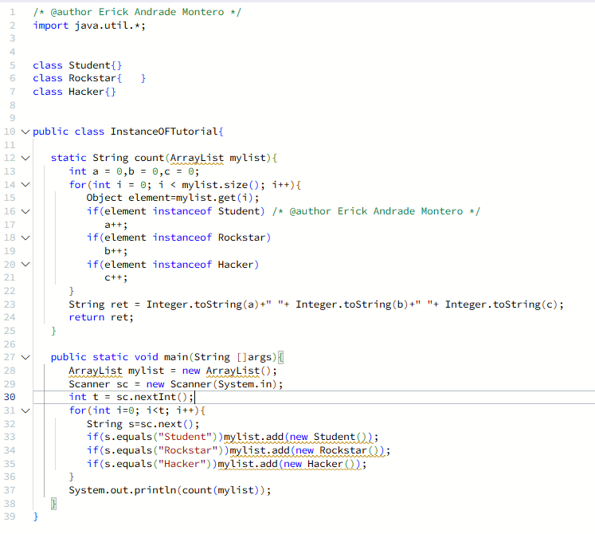
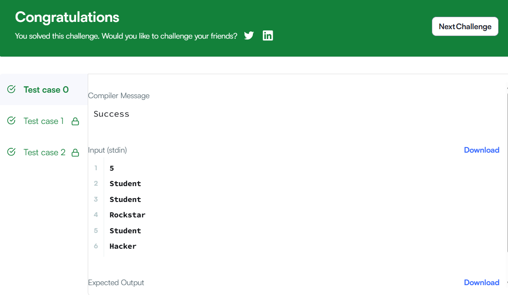

# 🔟 Java Instanceof keyword

`POO · instanceof` · U2-AA-3 · Ejercicio 10 de 13

[⬅️ Anterior](../09-Java-Method-Overriding-2-Super/README.md) · [📑 Índice de la actividad](../README.md#indice) · [Siguiente ➡️](../11-Java-Iterator/README.md)

- **Pide:** Contar cuántos objetos `Student`, `Rockstar` y `Hacker` hay en un `ArrayList`, completando 3 líneas.
- **Idea:** `element instanceof Clase` pregunta el tipo real del objeto antes de contarlo.

📄 **Código:** [`InstanceOFTutorial.java`](InstanceOFTutorial.java)

## 📸 Evidencias

**Enunciado**

**Código**

**Resultado**

[⬅️ Anterior](../09-Java-Method-Overriding-2-Super/README.md) · [📑 Índice de la actividad](../README.md#indice) · [Siguiente ➡️](../11-Java-Iterator/README.md)

