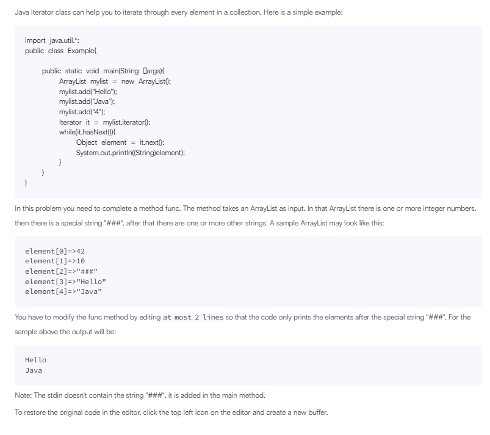
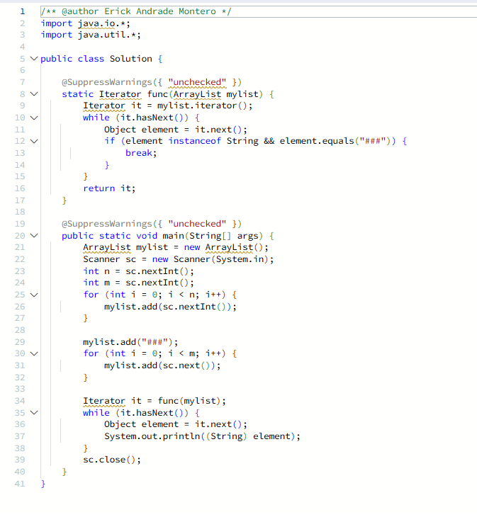
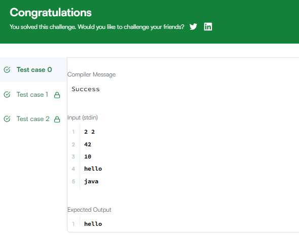

# 1️⃣1️⃣ Java Iterator

`Colecciones · Iterator` · U2-AA-3 · Ejercicio 11 de 13

[⬅️ Anterior](../10-Java-Instanceof-Keyword/README.md) · [📑 Índice de la actividad](../README.md#indice) · [Siguiente ➡️](../12-Java-Exception-Handling-Try-Catch/README.md)

- **Pide:** Modificar 2 líneas para imprimir solo lo que viene después de la cadena especial `###`.
- **Idea:** Se avanza con `it.next()` hasta el primer `String` (`instanceof String`); el resto queda en el iterador.

📄 **Código:** [`Main.java`](Main.java)

## 📸 Evidencias

**Enunciado**

**Código**

**Resultado**

[⬅️ Anterior](../10-Java-Instanceof-Keyword/README.md) · [📑 Índice de la actividad](../README.md#indice) · [Siguiente ➡️](../12-Java-Exception-Handling-Try-Catch/README.md)

