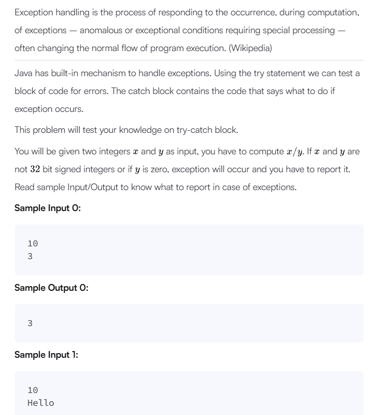
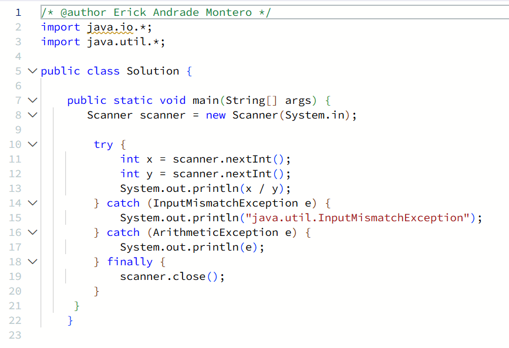
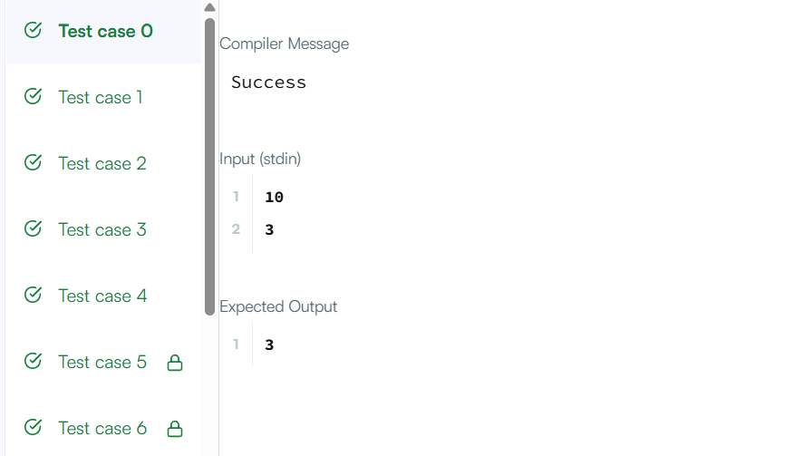

# 1️⃣2️⃣ Java Exception Handling (Try-catch)

`Excepciones` · U2-AA-3 · Ejercicio 12 de 13

[⬅️ Anterior](../11-Java-Iterator/README.md) · [📑 Índice de la actividad](../README.md#indice) · [Siguiente ➡️](../13-Java-Exception-Handling/README.md)

- **Pide:** Dividir `x / y` y reportar si hay división por cero o si la entrada no es un entero.
- **Idea:** `try-catch` con `ArithmeticException` e `InputMismatchException`; `finally` cierra el `Scanner`.

📄 **Código:** [`Solution.java`](Solution.java)

## 📸 Evidencias

**Enunciado**

**Código**

**Resultado**

[⬅️ Anterior](../11-Java-Iterator/README.md) · [📑 Índice de la actividad](../README.md#indice) · [Siguiente ➡️](../13-Java-Exception-Handling/README.md)

