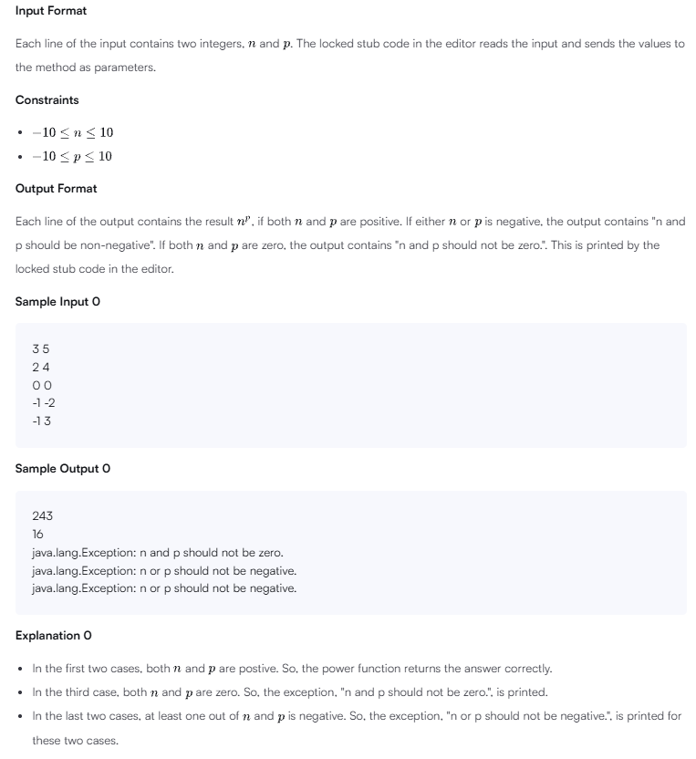
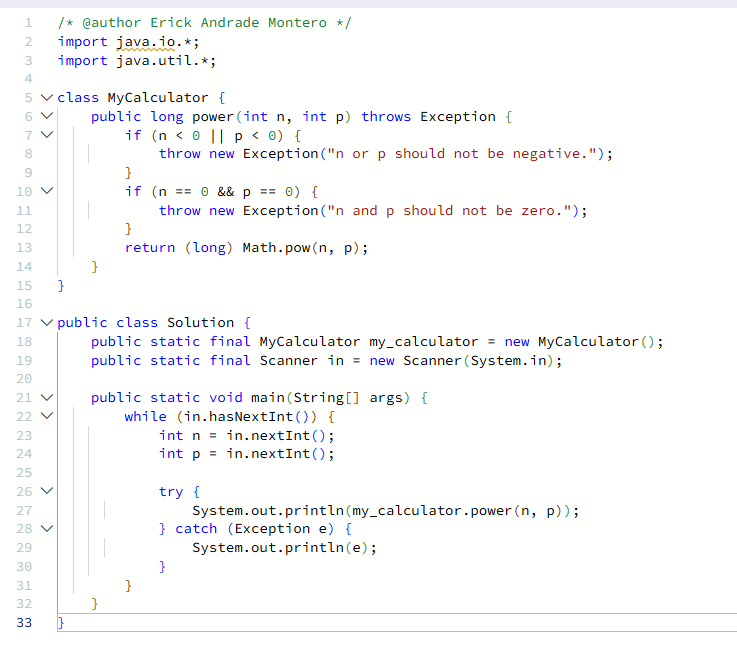
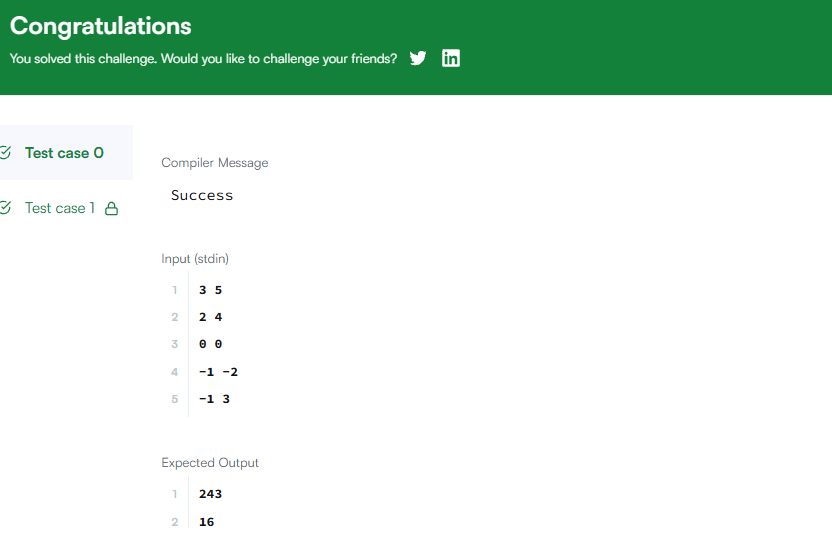

# 1️⃣3️⃣ Java Exception Handling

`Excepciones` · U2-AA-3 · Ejercicio 13 de 13

[⬅️ Anterior](../12-Java-Exception-Handling-Try-Catch/README.md) · [📑 Índice de la actividad](../README.md#indice) · [🏁 Conclusiones](../README.md#conclusiones)

- **Pide:** Crear `power(n, p)` que calcule n^p y lance excepción si hay negativos o ambos son cero.
- **Idea:** `throw new Exception(...)` en el método y `try-catch` en `main` que imprime el error.

📄 **Código:** [`Solution.java`](Solution.java)

## 📸 Evidencias

**Enunciado**

**Código**

**Resultado**

[⬅️ Anterior](../12-Java-Exception-Handling-Try-Catch/README.md) · [📑 Índice de la actividad](../README.md#indice) · [🏁 Conclusiones](../README.md#conclusiones)

