

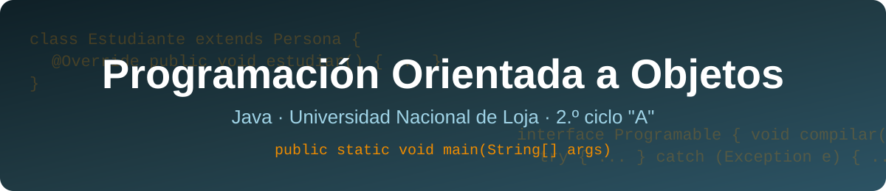

# U2-AA-3 · Ejercicios de Programación Orientada a Objetos con Java

<a href="../README.md">🏠 Inicio</a> ·
<a href="#indice">📑 Índice</a> ·
<a href="#ejercicios">🧩 Ejercicios</a> ·
<a href="#conclusiones">🏁 Conclusiones</a> ·
<a href="#ia">🤖 Declaración de IA</a>

## 🪪 Datos

| | |
|---|---|
| **Universidad** | Universidad Nacional de Loja (UNL) |
| **Materia** | Programación Orientada a Objetos (POO) |
| **Docente** | Ing. Wilman Chamba |
| **Ciclo** | Segundo ciclo · Paralelo "A" |
| **Estudiante** | Erick Emanuel Andrade Montero |
| **Actividad** | U2-AA-3 (Unidad 2 · Actividad de Aprendizaje 3) |
| **Cuenta HackerRank** | [@erick_andrade](https://www.hackerrank.com/profile/erick_andrade) |

## 🎯 Sobre la actividad

Práctica de los principios de la POO con Java resolviendo ejercicios en línea de [HackerRank](https://www.hackerrank.com/domains/java). Subdominios elegidos: **Object Oriented Programming**, **Exception Handling** y **BigNumber**, para un total de **13 ejercicios**.

## 📑 Índice

Haz clic en el nombre del ejercicio para ver su explicación, o en el código/evidencias para abrirlos directamente.

| # | Ejercicio | Concepto | Código | Evidencias |
|:-:|---|---|:-:|:-:|
| 1 | [Java BigDecimal](#ej1) | BigNumber | [`Solution.java`](01-Java-BigDecimal/Solution.java) | [📸](01-Java-BigDecimal/evidencias) |
| 2 | [Java Primality Test](#ej2) | BigNumber | [`Solution.java`](02-Java-Primality-Test/Solution.java) | [📸](02-Java-Primality-Test/evidencias) |
| 3 | [Java BigInteger](#ej3) | BigNumber | [`Solution.java`](03-Java-BigInteger/Solution.java) | [📸](03-Java-BigInteger/evidencias) |
| 4 | [Java Inheritance I](#ej4) | POO · Herencia | [`Solution.java`](04-Java-Inheritance-I/Solution.java) | [📸](04-Java-Inheritance-I/evidencias) |
| 5 | [Java Inheritance II](#ej5) | POO · Herencia | [`Solution.java`](05-Java-Inheritance-II/Solution.java) | [📸](05-Java-Inheritance-II/evidencias) |
| 6 | [Java Abstract Class](#ej6) | POO · Clases abstractas | [`Main.java`](06-Java-Abstract-Class/Main.java) | [📸](06-Java-Abstract-Class/evidencias) |
| 7 | [Java Interface](#ej7) | POO · Interfaces | [`Solution.java`](07-Java-Interface/Solution.java) | [📸](07-Java-Interface/evidencias) |
| 8 | [Java Method Overriding](#ej8) | POO · Polimorfismo | [`Solution.java`](08-Java-Method-Overriding/Solution.java) | [📸](08-Java-Method-Overriding/evidencias) |
| 9 | [Java Method Overriding 2 (Super Keyword)](#ej9) | POO · Polimorfismo / super | [`Solution.java`](09-Java-Method-Overriding-2-Super/Solution.java) | [📸](09-Java-Method-Overriding-2-Super/evidencias) |
| 10 | [Java Instanceof keyword](#ej10) | POO · instanceof | [`InstanceOFTutorial.java`](10-Java-Instanceof-Keyword/InstanceOFTutorial.java) | [📸](10-Java-Instanceof-Keyword/evidencias) |
| 11 | [Java Iterator](#ej11) | Colecciones · Iterator | [`Main.java`](11-Java-Iterator/Main.java) | [📸](11-Java-Iterator/evidencias) |
| 12 | [Java Exception Handling (Try-catch)](#ej12) | Excepciones | [`Solution.java`](12-Java-Exception-Handling-Try-Catch/Solution.java) | [📸](12-Java-Exception-Handling-Try-Catch/evidencias) |
| 13 | [Java Exception Handling](#ej13) | Excepciones | [`Solution.java`](13-Java-Exception-Handling/Solution.java) | [📸](13-Java-Exception-Handling/evidencias) |

**Atajos:** [🏁 Conclusiones](#conclusiones) · [🤖 Declaración de IA](#ia) · [🏠 Inicio del repositorio](../README.md)

---

## 🧩 Ejercicios

### 1️⃣ Java BigDecimal

`BigNumber`

- **Pide:** Ordenar de mayor a menor un arreglo de números reales en texto, sin cambiar su formato; los empates conservan el orden de entrada.
- **Idea:** `Arrays.sort` con un `Comparator` que compara con `BigDecimal` (el sort de objetos es estable).

📄 [Ver código](01-Java-BigDecimal/Solution.java) · 🖼️ [Evidencias](01-Java-BigDecimal/evidencias) · 📂 [Carpeta del ejercicio](01-Java-BigDecimal/)

📸 Ver evidencias

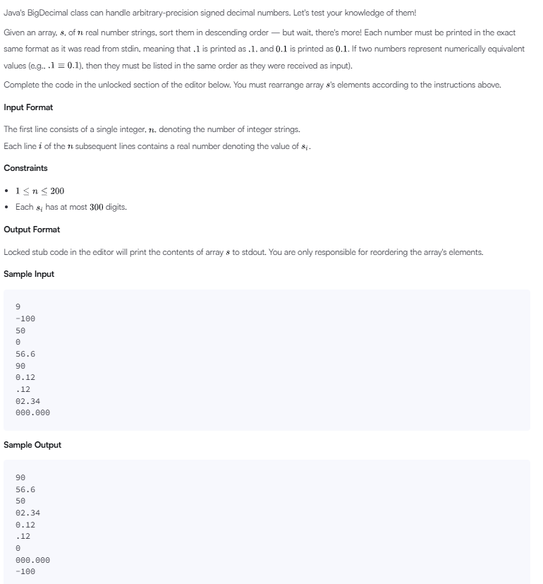
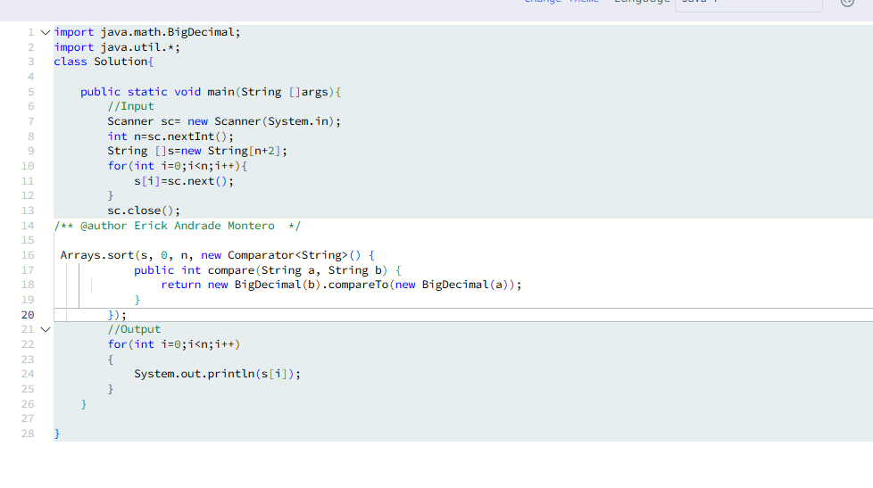

⬆️ [Índice](#indice) · [Siguiente](#ej2) ➡️

---

### 2️⃣ Java Primality Test

`BigNumber`

- **Pide:** Decir si un número muy grande es primo (`prime`) o no (`not prime`).
- **Idea:** `BigInteger.isProbablePrime(100)` evita recorrer divisores en números enormes.

📄 [Ver código](02-Java-Primality-Test/Solution.java) · 🖼️ [Evidencias](02-Java-Primality-Test/evidencias) · 📂 [Carpeta del ejercicio](02-Java-Primality-Test/)

📸 Ver evidencias

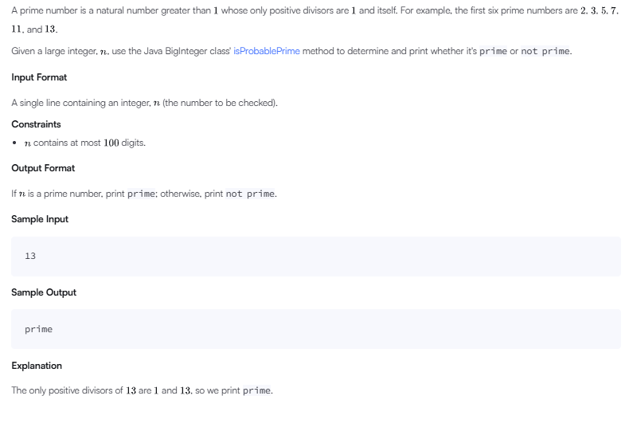
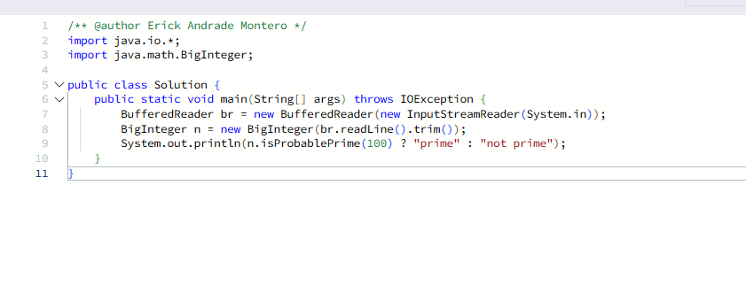
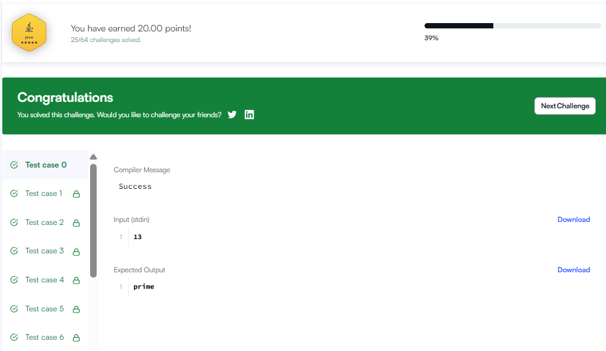

⬅️ [Anterior](#ej1) · ⬆️ [Índice](#indice) · [Siguiente](#ej3) ➡️

---

### 3️⃣ Java BigInteger

`BigNumber`

- **Pide:** Leer dos enteros gigantes e imprimir su suma y su producto.
- **Idea:** `BigInteger` con `add()` y `multiply()`: no hay desbordamiento como con `int` o `long`.

📄 [Ver código](03-Java-BigInteger/Solution.java) · 🖼️ [Evidencias](03-Java-BigInteger/evidencias) · 📂 [Carpeta del ejercicio](03-Java-BigInteger/)

📸 Ver evidencias

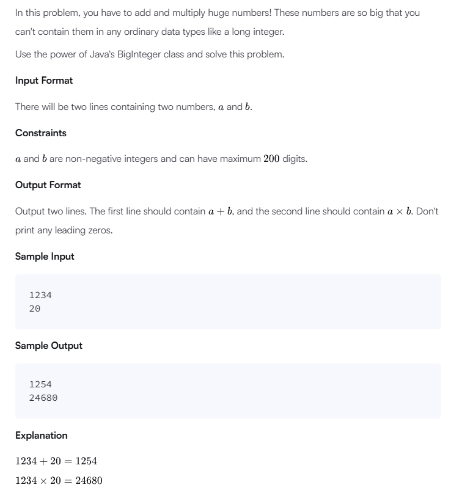
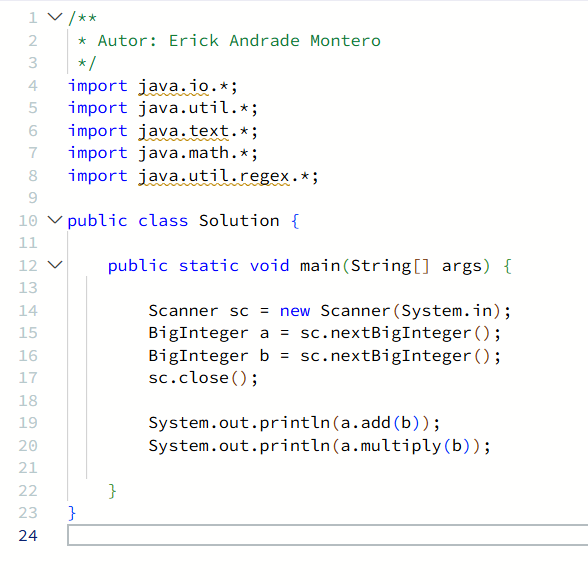
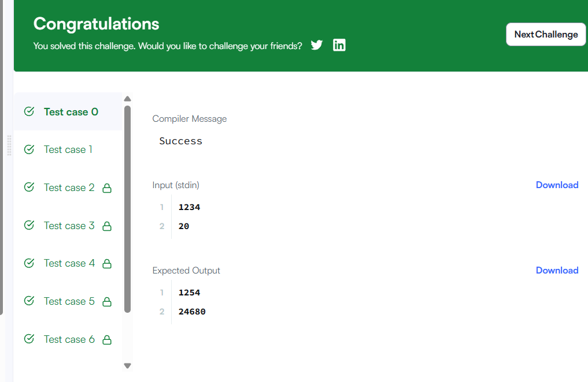

⬅️ [Anterior](#ej2) · ⬆️ [Índice](#indice) · [Siguiente](#ej4) ➡️

---

### 4️⃣ Java Inheritance I

`POO · Herencia`

- **Pide:** Hacer que `Bird` herede de `Animal` y tenga además `fly()` y `sing()`.
- **Idea:** Con `extends`, `Bird` reutiliza `walk()` del padre y agrega sus propios métodos.

📄 [Ver código](04-Java-Inheritance-I/Solution.java) · 🖼️ [Evidencias](04-Java-Inheritance-I/evidencias) · 📂 [Carpeta del ejercicio](04-Java-Inheritance-I/)

📸 Ver evidencias

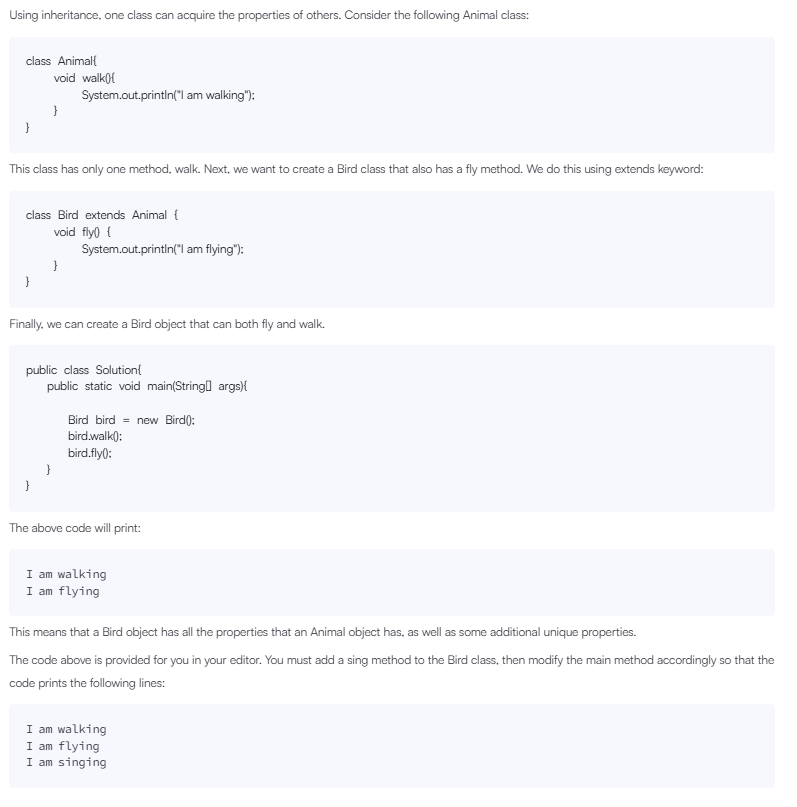
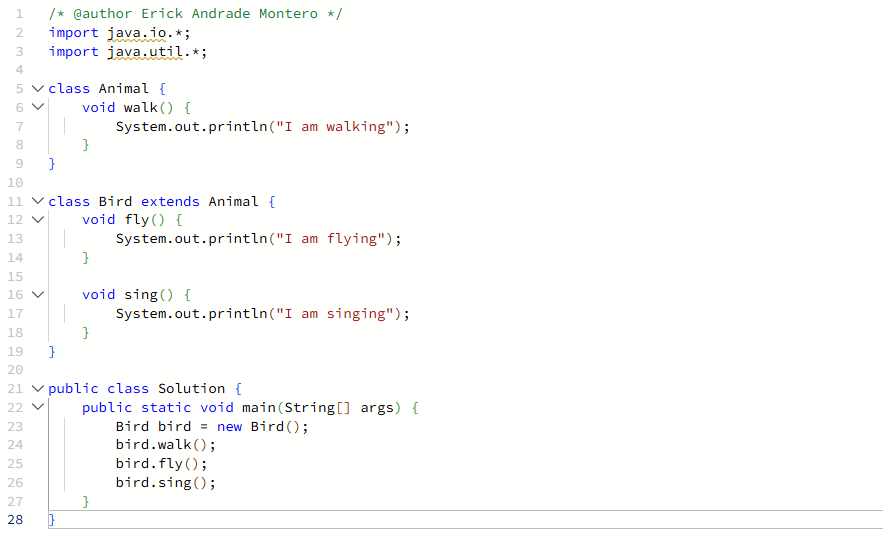
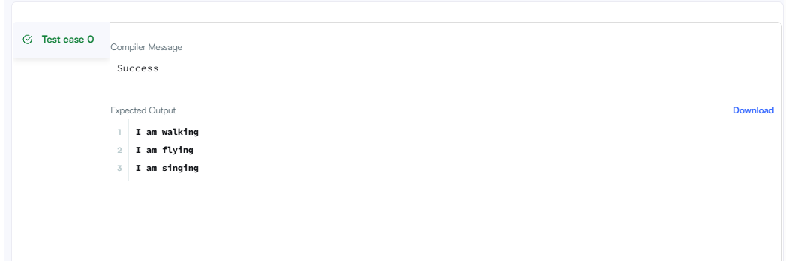

⬅️ [Anterior](#ej3) · ⬆️ [Índice](#indice) · [Siguiente](#ej5) ➡️

---

### 5️⃣ Java Inheritance II

`POO · Herencia`

- **Pide:** Crear `Adder` que herede de `Arithmetic` y usar su método `add` sin reescribirlo.
- **Idea:** `class Adder extends Arithmetic` y `getClass().getSuperclass().getName()` para mostrar el padre.

📄 [Ver código](05-Java-Inheritance-II/Solution.java) · 🖼️ [Evidencias](05-Java-Inheritance-II/evidencias) · 📂 [Carpeta del ejercicio](05-Java-Inheritance-II/)

📸 Ver evidencias

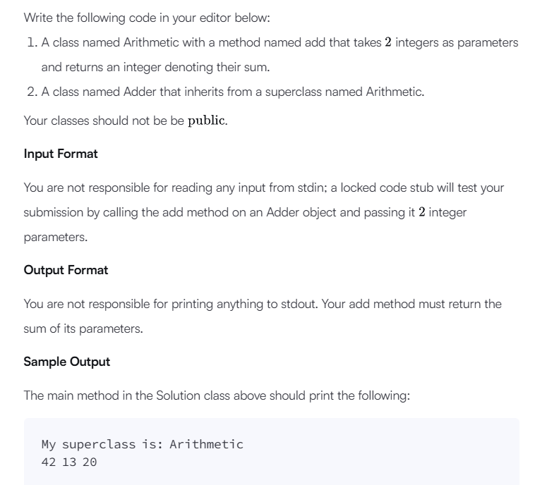
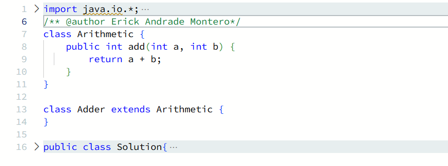
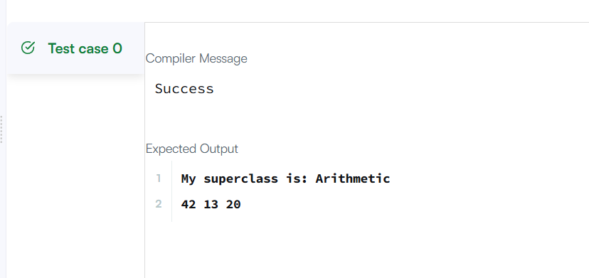

⬅️ [Anterior](#ej4) · ⬆️ [Índice](#indice) · [Siguiente](#ej6) ➡️

---

### 6️⃣ Java Abstract Class

`POO · Clases abstractas`

- **Pide:** Implementar `MyBook` a partir de la clase abstracta `Book` para guardar y mostrar un título.
- **Idea:** Una clase abstracta no se instancia: la hija debe implementar `setTitle`.

📄 [Ver código](06-Java-Abstract-Class/Main.java) · 🖼️ [Evidencias](06-Java-Abstract-Class/evidencias) · 📂 [Carpeta del ejercicio](06-Java-Abstract-Class/)

📸 Ver evidencias

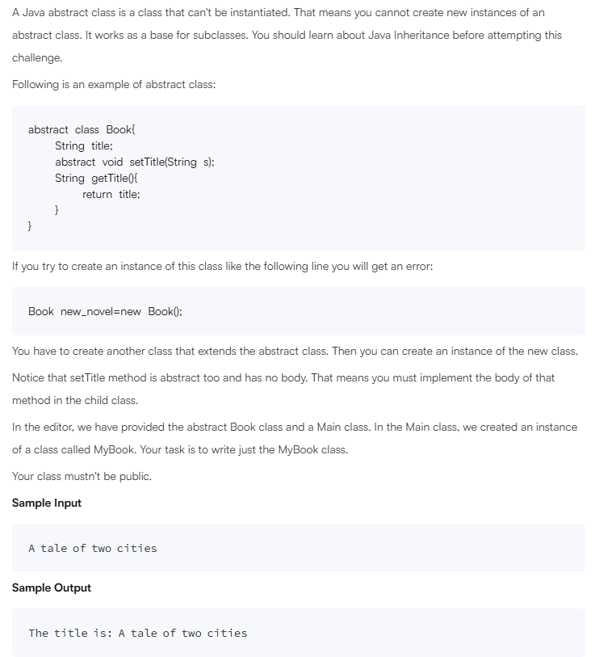
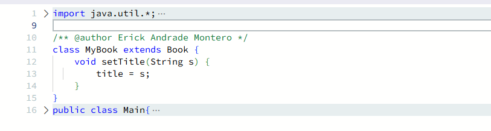
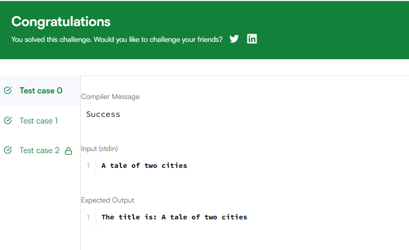

⬅️ [Anterior](#ej5) · ⬆️ [Índice](#indice) · [Siguiente](#ej7) ➡️

---

### 7️⃣ Java Interface

`POO · Interfaces`

- **Pide:** Implementar `divisor_sum(n)` (suma de los divisores de n) en `MyCalculator`, que implementa `AdvancedArithmetic`.
- **Idea:** Se recorre hasta √n sumando `i` y `n/i`; la interfaz obliga a definir el método.

📄 [Ver código](07-Java-Interface/Solution.java) · 🖼️ [Evidencias](07-Java-Interface/evidencias) · 📂 [Carpeta del ejercicio](07-Java-Interface/)

📸 Ver evidencias

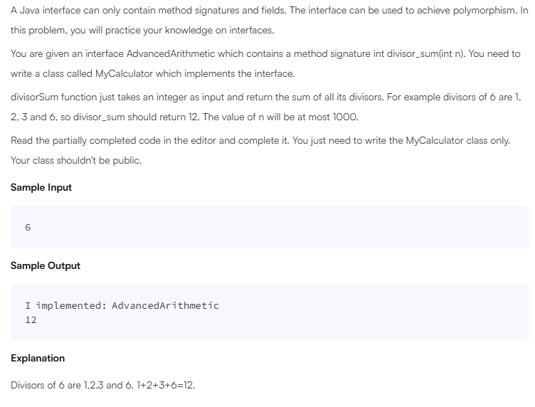
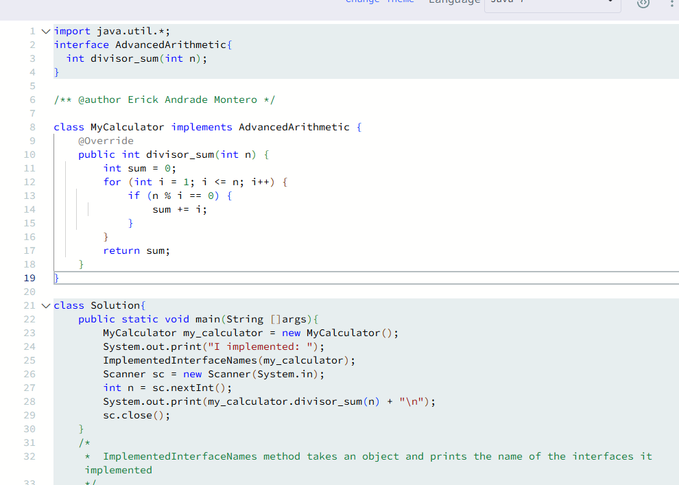
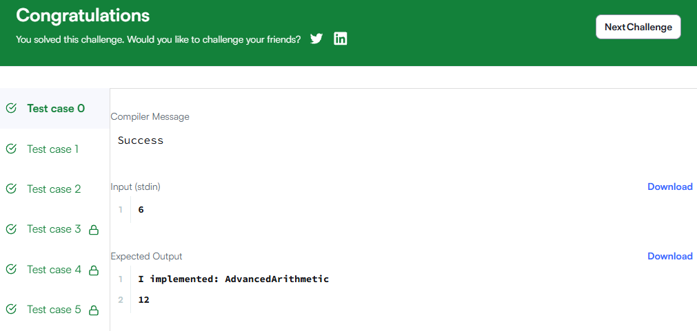

⬅️ [Anterior](#ej6) · ⬆️ [Índice](#indice) · [Siguiente](#ej8) ➡️

---

### 8️⃣ Java Method Overriding

`POO · Polimorfismo`

- **Pide:** Sobrescribir en `Soccer` el método `getNumberOfTeamMembers` para que diga que hay 11 jugadores.
- **Idea:** `@Override` cambia el comportamiento heredado; Java elige la versión según el objeto real.

📄 [Ver código](08-Java-Method-Overriding/Solution.java) · 🖼️ [Evidencias](08-Java-Method-Overriding/evidencias) · 📂 [Carpeta del ejercicio](08-Java-Method-Overriding/)

📸 Ver evidencias

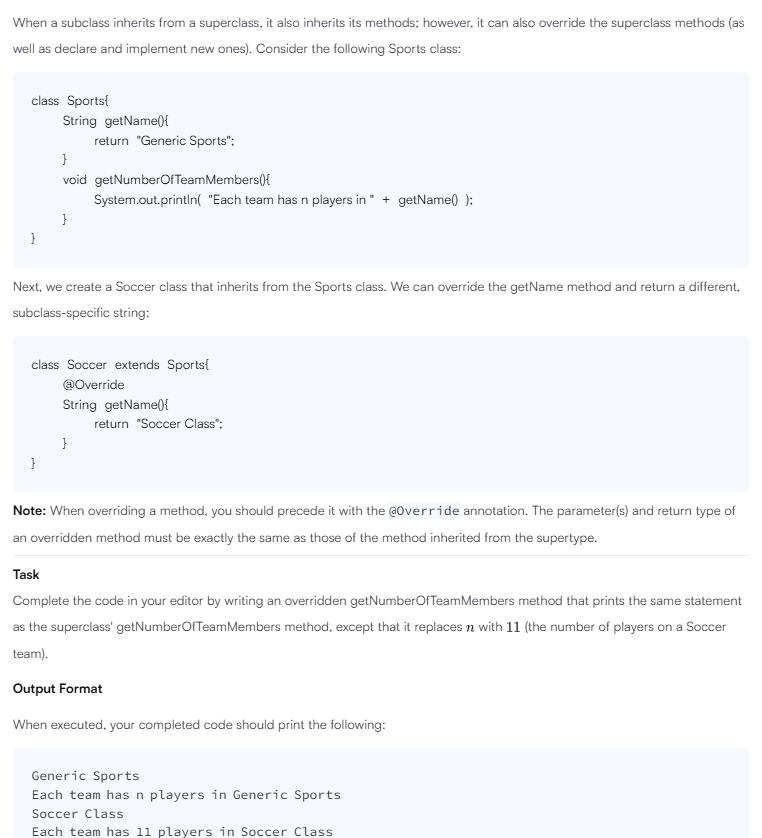
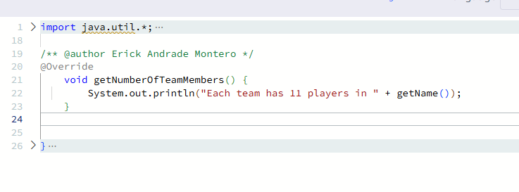
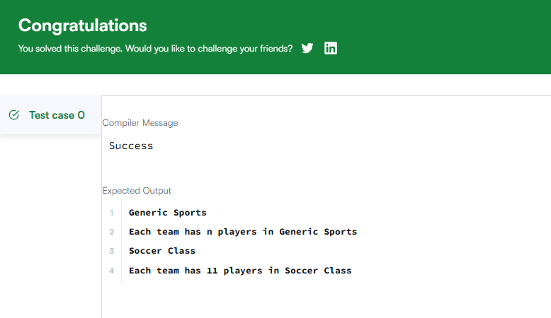

⬅️ [Anterior](#ej7) · ⬆️ [Índice](#indice) · [Siguiente](#ej9) ➡️

---

### 9️⃣ Java Method Overriding 2 (Super Keyword)

`POO · Polimorfismo / super`

- **Pide:** Hacer que `MotorCycle` llame al `define_me()` de su clase padre `BiCycle`, no al suyo.
- **Idea:** `super.define_me()` accede a la versión del padre aunque el método esté sobrescrito.

📄 [Ver código](09-Java-Method-Overriding-2-Super/Solution.java) · 🖼️ [Evidencias](09-Java-Method-Overriding-2-Super/evidencias) · 📂 [Carpeta del ejercicio](09-Java-Method-Overriding-2-Super/)

📸 Ver evidencias

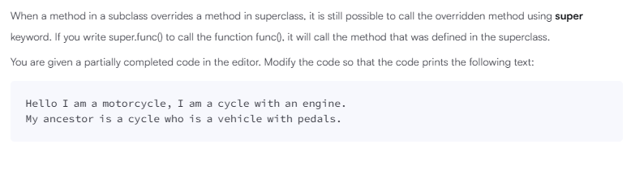
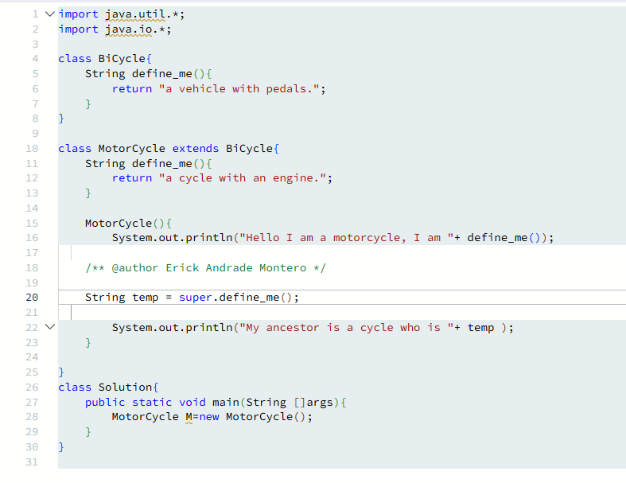
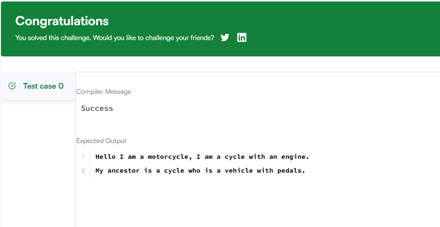

⬅️ [Anterior](#ej8) · ⬆️ [Índice](#indice) · [Siguiente](#ej10) ➡️

---

### 🔟 Java Instanceof keyword

`POO · instanceof`

- **Pide:** Contar cuántos objetos `Student`, `Rockstar` y `Hacker` hay en un `ArrayList`, completando 3 líneas.
- **Idea:** `element instanceof Clase` pregunta el tipo real del objeto antes de contarlo.

📄 [Ver código](10-Java-Instanceof-Keyword/InstanceOFTutorial.java) · 🖼️ [Evidencias](10-Java-Instanceof-Keyword/evidencias) · 📂 [Carpeta del ejercicio](10-Java-Instanceof-Keyword/)

📸 Ver evidencias

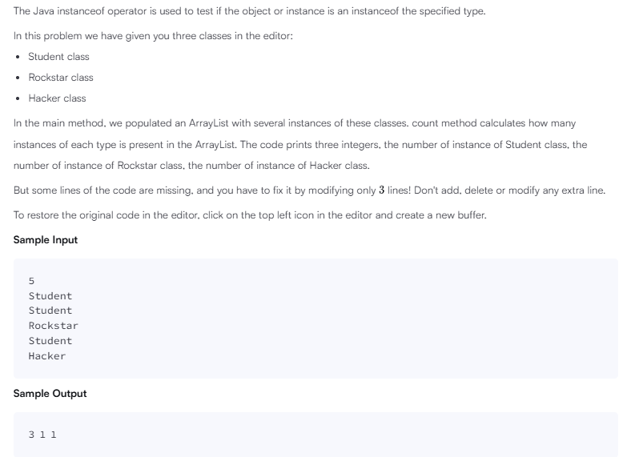
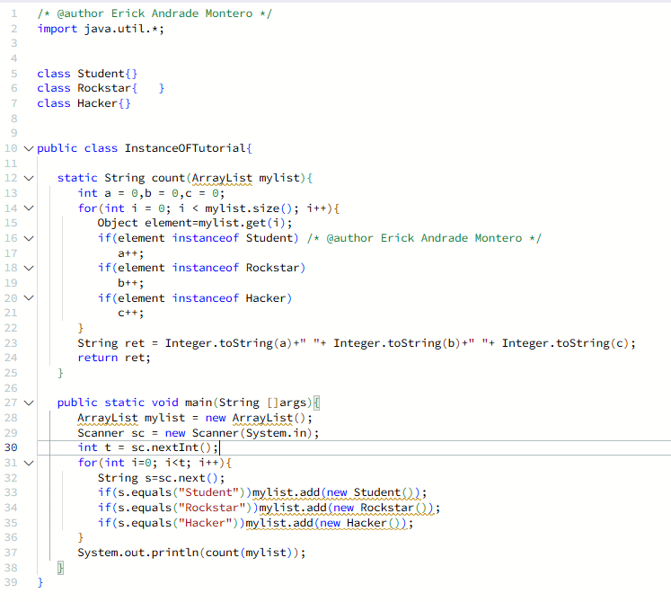
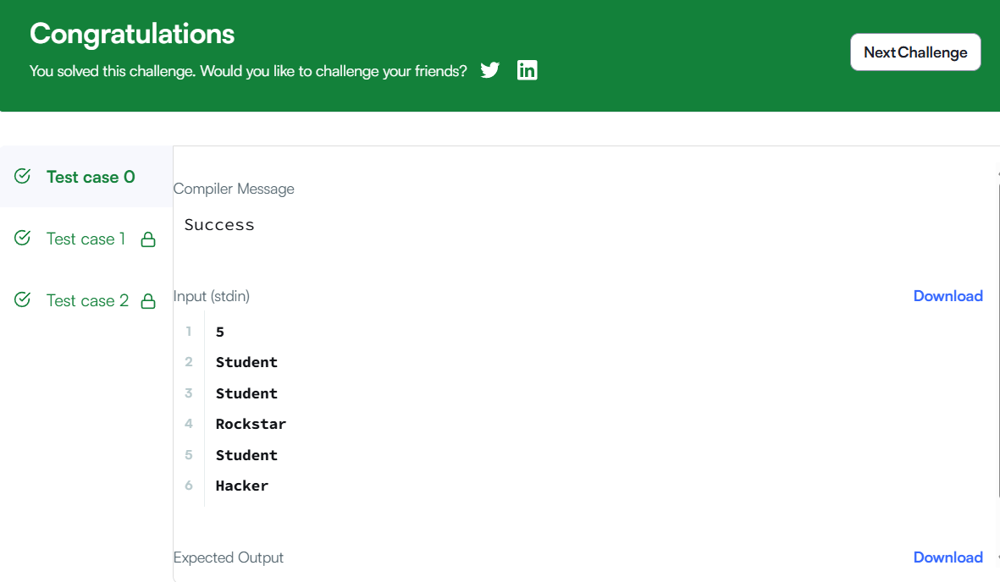

⬅️ [Anterior](#ej9) · ⬆️ [Índice](#indice) · [Siguiente](#ej11) ➡️

---

### 1️⃣1️⃣ Java Iterator

`Colecciones · Iterator`

- **Pide:** Modificar 2 líneas para imprimir solo lo que viene después de la cadena especial `###`.
- **Idea:** Se avanza con `it.next()` hasta el primer `String` (`instanceof String`); el resto queda en el iterador.

📄 [Ver código](11-Java-Iterator/Main.java) · 🖼️ [Evidencias](11-Java-Iterator/evidencias) · 📂 [Carpeta del ejercicio](11-Java-Iterator/)

📸 Ver evidencias

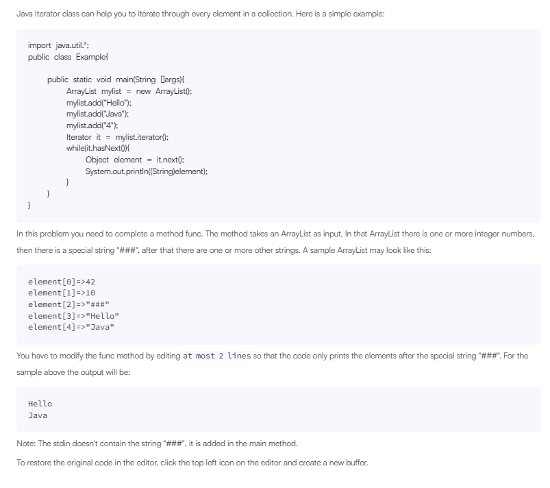
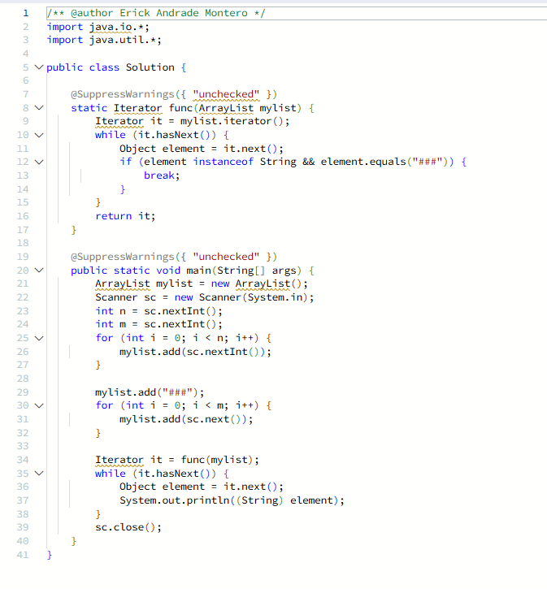
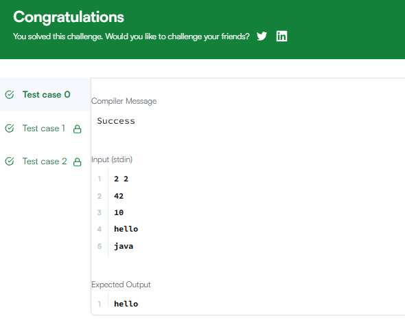

⬅️ [Anterior](#ej10) · ⬆️ [Índice](#indice) · [Siguiente](#ej12) ➡️

---

### 1️⃣2️⃣ Java Exception Handling (Try-catch)

`Excepciones`

- **Pide:** Dividir `x / y` y reportar si hay división por cero o si la entrada no es un entero.
- **Idea:** `try-catch` con `ArithmeticException` e `InputMismatchException`; `finally` cierra el `Scanner`.

📄 [Ver código](12-Java-Exception-Handling-Try-Catch/Solution.java) · 🖼️ [Evidencias](12-Java-Exception-Handling-Try-Catch/evidencias) · 📂 [Carpeta del ejercicio](12-Java-Exception-Handling-Try-Catch/)

📸 Ver evidencias

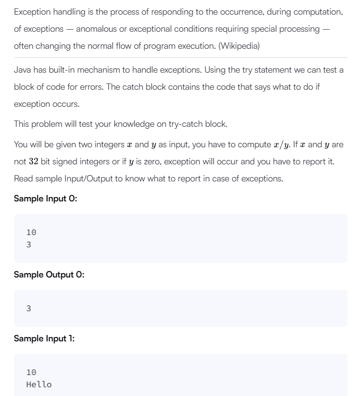
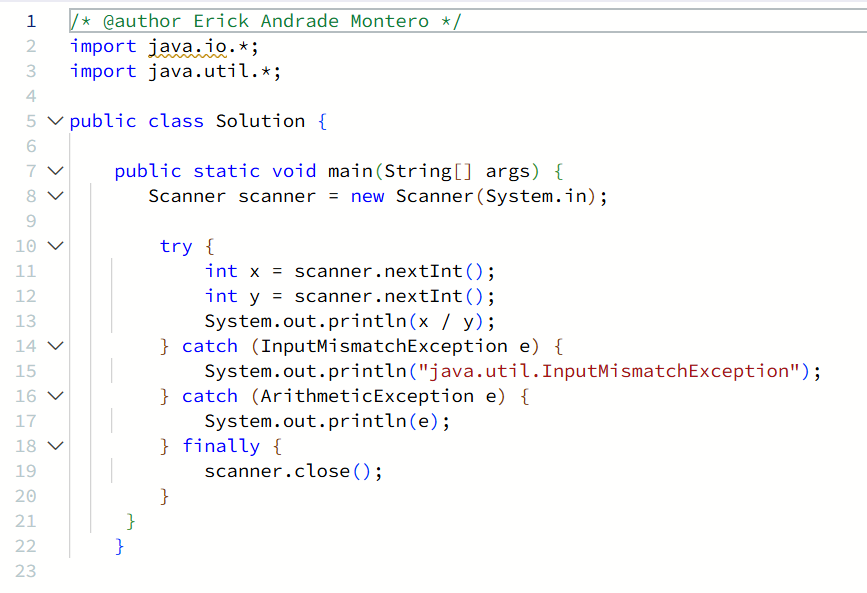
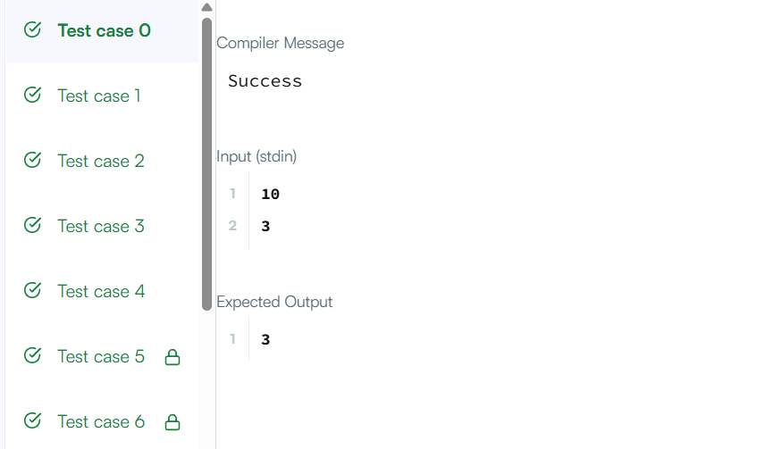

⬅️ [Anterior](#ej11) · ⬆️ [Índice](#indice) · [Siguiente](#ej13) ➡️

---

### 1️⃣3️⃣ Java Exception Handling

`Excepciones`

- **Pide:** Crear `power(n, p)` que calcule n^p y lance excepción si hay negativos o ambos son cero.
- **Idea:** `throw new Exception(...)` en el método y `try-catch` en `main` que imprime el error.

📄 [Ver código](13-Java-Exception-Handling/Solution.java) · 🖼️ [Evidencias](13-Java-Exception-Handling/evidencias) · 📂 [Carpeta del ejercicio](13-Java-Exception-Handling/)

📸 Ver evidencias

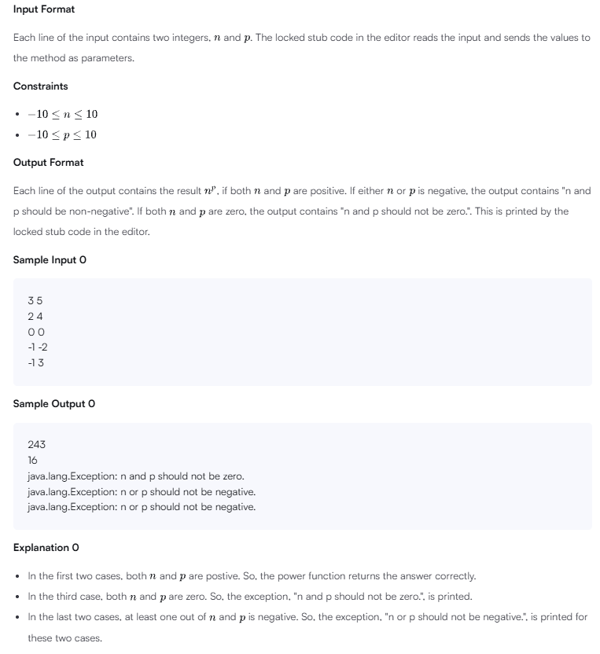
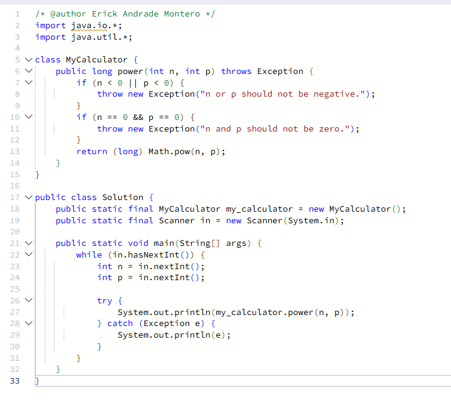
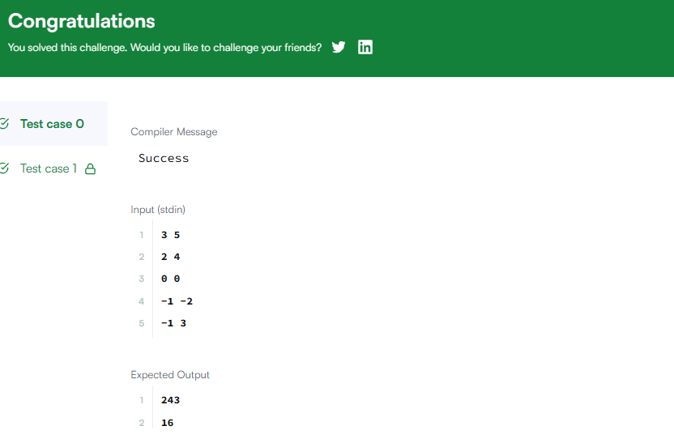

⬅️ [Anterior](#ej12) · ⬆️ [Índice](#indice) · [Conclusiones](#conclusiones) ➡️

---

## 🏁 Conclusiones

- Se aplicaron los pilares de la POO: **herencia** (Inheritance I y II), **abstracción** (clase abstracta e interfaz) y **polimorfismo** (`@Override` y `super`).
- `instanceof` e `Iterator` permitieron trabajar con objetos de distintos tipos dentro de una colección.
- El manejo de excepciones (`try-catch-finally` y `throw`) hace que el programa responda a los errores sin detenerse de golpe.
- `BigDecimal` y `BigInteger` resuelven los límites de `int` y `long` con números muy grandes o con decimales que deben ser exactos.
- Algunos ejercicios limitan cuántas líneas se pueden modificar (Instanceof e Iterator): hay que leer bien el enunciado, porque hasta un comentario extra en otra línea puede invalidar la solución.
- **Resultado:** 13 de 13 ejercicios resueltos y verificados en HackerRank.

⬅️ [Anterior](#ej13) · ⬆️ [Índice](#indice) · [Declaración de IA](#ia) ➡️

---

## 🤖 Declaración del uso de IA

De acuerdo con las normas de integridad académica, declaro el uso de inteligencia artificial en esta actividad:

| | |
|---|---|
| **Herramienta** | Claude (Anthropic) |
| **Para qué se usó** | Apoyo en la resolución de los ejercicios, y en la creación de la estructura y la documentación de este repositorio. |
| **Verificación** | Cada solución fue probada en HackerRank con los casos de prueba de la plataforma (evidencias en cada carpeta). |
| **Autoría** | Cada código lleva el comentario `@author Erick Andrade Montero`. |
| **Responsabilidad** | Yo revisé cada sección de este repositorio y soy responsable de su contenido. |

⬅️ [Conclusiones](#conclusiones) · ⬆️ [Índice](#indice) · [🏠 Inicio del repositorio](../README.md)

---

<a href="#inicio">⬆️ Volver arriba</a>

